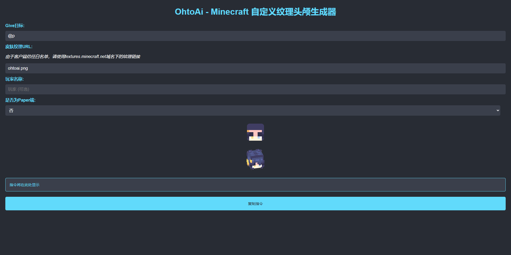

# Minecraft 自定义纹理头颅生成器

一个用于生成 Minecraft 自定义纹理头颅 `give` 命令的小工具。输入皮肤纹理 URL 或上传本地 PNG，即可在网页中预览 3D 头颅模型并生成适用于 Java 版 1.13–1.20 的命令。



## 功能

- 输入目标选择器（默认 `@p`）、玩家名、皮肤纹理 URL
- 上传本地 PNG 皮肤，服务端按 MD5 去重保存并返回可访问的纹理地址
- 使用 three.js 实时预览头颅 3D 模型
- 生成原版 / Paper 两种 `give` 命令
- 一键复制命令
- 健康检查接口，便于部署监控

## 在线使用

<https://head.mc.ohtoai.top/>

> 由于 Minecraft 客户端的纹理信任白名单，纹理链接最好使用 `textures.minecraft.net` 域名下的地址；使用自建域名时，部分客户端可能无法显示纹理。

## 本地运行

### 环境要求

- Python 3.8+
- Flask
- 支持 WebGL 的现代浏览器

```bash
pip install flask
python main.py
```

打开 <http://localhost:8050/>。

### 关于上传目录

`main.py` 中的上传目录默认是 Linux 服务器路径：

```python
UPLOAD_FOLDER = '/opt/public/mc/skins'
```

在本地运行时请改成可写路径（例如 `./uploads`），或提前创建 `/opt/public/mc/skins` 目录。

## 接口

| 方法 | 路径 | 说明 |
|---|---|---|
| `GET` | `/` | 前端页面 |
| `POST` | `/upload` | 上传 PNG，返回 `{ "success": true, "url": "/texture/<md5>.png" }` |
| `GET` | `/texture/<filename>` | 获取已上传的纹理 |
| `GET` | `/health_check` | 健康检查，返回 `{ "success": true }` |
| `GET` | `/<path>` | `static/` 下的静态资源 |

上传仅接受 `.png` 文件，文件名由 MD5 生成，重复上传不会重复保存。

## 部署说明

- 前端是纯静态页面，可通过 GitHub Pages 或任意静态托管部署（仓库包含 `.github/workflows/static.yml`）。
- 上传和纹理服务需要运行 `main.py` 的 Python 后端，并保证 `UPLOAD_FOLDER` 可写、可被 Web 访问。

## 项目结构

```text
main.py                 Flask 后端
static/index.html       前端页面
static/scripts/3d.js    three.js 头颅预览
static/scripts/upload.js 上传逻辑
static/styles/          CSS
img/cap.png             截图
```

## License

[MIT](LICENSE)
